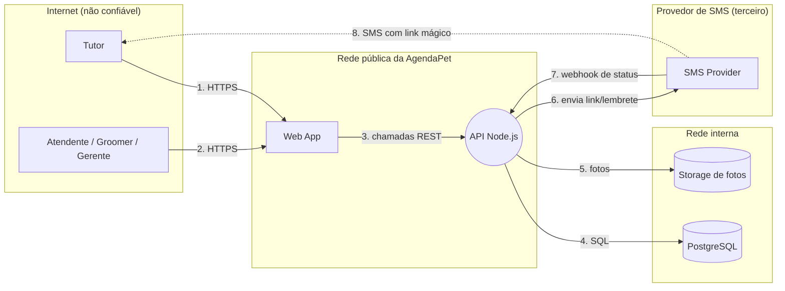

# AgendaPet — modelo de ameaças resolvido (exemplo)

Este documento mostra o **formato e o nível de detalhe** esperados. A planilha ([`exemplo-agendapet.xlsx`](exemplo-agendapet.xlsx)) tem as mesmas partes: DFD, STRIDE, DREAD e Top 5.
Cada ameaça aponta a **evidência** nos artefatos do cenário.

## 1. DFD nível 1 e fronteiras de confiança

| Fronteira | Onde os dados cruzam |
|---|---|
| Internet → rede pública | fluxos 1, 2, 3 |
| Rede pública → rede interna | fluxos 4, 5 |
| AgendaPet ↔ terceiro (SMS) | fluxos 6, 7 e 8 |

## 2. Ameaças (STRIDE)

| ID | Cat. | Elemento | Ameaça (quem / como / impacto) | Evidência | Mitigação |
|---|---|---|---|---|---|
| A01 | S | Login (`/login/validar`) | Atacante adivinha o token de 6 caracteres por força bruta e entra na conta do tutor | `openapi.yaml`: token de 6 alfanuméricos, endpoint sem `security` | Token aleatório ≥ 128 bits, uso único, expira em 10 min; rate limit por IP e por telefone |
| A02 | S | Webhook `/sms/status` | Atacante envia status falsos de entrega e o sistema acredita que o lembrete foi entregue | `openapi.yaml`: `/v1/sms/status` com `security: []` | Validar assinatura HMAC do provedor; restringir por IP; rejeitar timestamp antigo |
| A03 | S | SMS (fluxo 8) | SIM swap ou SMS interceptado leva ao sequestro da conta | Login só por SMS | Aceitar o risco para dado de baixa criticidade; oferecer 2º fator opcional; sessão curta |
| A04 | T | `DELETE /agendamentos/{id}` | Tutor cancela o agendamento de outro trocando o `id` | `openapi.yaml`: id inteiro sequencial; só exige sessão | Verificar no servidor que o agendamento pertence ao usuário; usar UUID |
| A05 | R | Reagendamento pelo atendente | Atendente reagenda em nome do tutor e depois nega; o tutor contesta | `README.md`: atendente age "em nome do tutor" | Log de auditoria imutável (quem, quando, valor antigo e novo) |
| A06 | I | `GET /agendamentos/{id}` | Tutor lê agendamento, telefone e endereço de outros (IDOR) | Mesma causa de A04 | Mesma mitigação de A04 |
| A07 | I | `GET /tutores` | Resposta devolve endereço completo ao atendente, que só precisa do nome | `openapi.yaml`: "nome, telefone e endereço completos" | Retornar o mínimo; mascarar endereço; mostrar completo só no atendimento |
| A08 | I | Logs da API | O token do link mágico fica na URL e é registrado nos logs por 90 dias | `dados.md`: logs com URL completa | Tirar token da URL (POST) ou mascarar nos logs; reduzir retenção |
| A09 | I | API (porta 3000) | Tráfego da API sem TLS na porta 3000 permite escuta | `docker-compose.yml`: `3000:3000` publicada | Expor só a 443 via proxy com TLS; fechar a 3000 |
| A10 | D | `/login/solicitar` | Atacante dispara milhares de SMS e gera custo financeiro (SMS pumping) | `openapi.yaml`: sem `security`, sem limite | Rate limit por IP/telefone; CAPTCHA; teto diário de SMS; alerta de custo |
| A11 | D | Backup do banco | Backup no mesmo servidor se perde junto com o banco | `dados.md`: "copiado para o mesmo servidor" | Backup em outro local, com teste de restauração |
| A12 | E | `/v1/admin/relatorios` | Tutor chama a rota de admin direto, pois o papel só é verificado no cliente | `dados.md`: o Web App esconde menus; a rota só exige sessão | Verificar o papel (RBAC) no servidor em todas as rotas `/admin` |

**Controles bem implementados (reconhecer):**
- `docker-compose.yml`: a rede `interna` é `internal: true`; banco e storage **não** são acessíveis da internet.
- Segredos (`DB_PASSWORD`, `SMS_API_KEY`) via variáveis de ambiente, não no código.
- Sessão com validade limitada (12 h).

## 3. DREAD

Como regra prática, pontue **pelo menos 8 ameaças** e escolha o Top 5 entre elas, pela média. O exemplo pontua 8 das 12.

| ID | D | R | E | A | D | **Média** | Nível |
|---|---|---|---|---|---|---|---|
| A12 | 9 | 9 | 7 | 9 | 5 | **7,8** | Alto |
| A06 | 7 | 9 | 8 | 7 | 6 | **7,4** | Alto |
| A10 | 5 | 9 | 8 | 4 | 7 | **6,6** | Médio |
| A01 | 8 | 7 | 6 | 6 | 5 | **6,4** | Médio |
| A05 | 5 | 8 | 3 | 5 | 3 | **4,8** | Médio |
| A11 | 7 | 3 | 2 | 8 | 3 | **4,6** | Médio |
| A02 | 3 | 7 | 5 | 4 | 4 | **4,6** | Médio |
| A08 | 6 | 5 | 3 | 6 | 3 | **4,6** | Médio |

**Justificativas (uma linha por critério):**

- **A12:** D9 qualquer tutor vira admin (faturamento, funcionários). R9 é uma chamada HTTP repetível. E7 precisa descobrir a rota. A9 toda a rede é afetada. Dis5 a rota aparece na documentação e no bundle do Web App.
- **A06:** D7 expõe nome, telefone e endereço (LGPD). R9 basta trocar o número do id. E8 qualquer tutor logado consegue, sem ferramenta especial. A7 todos os tutores podem ser lidos. Dis6 o id sequencial denuncia o padrão.
- **A10:** D5 o dano é financeiro, sem vazamento de dados. R9 é totalmente automatizável. E8 é um simples loop de requisições. A4 afeta a empresa mais que os tutores. Dis7 o endpoint é público e documentado.
- **A01:** D8 toma a conta de um tutor. R7 depende de volume de tentativas. E6 exige script de força bruta. A6 afeta quem tiver um link ativo. Dis5 só se descobre sabendo que o token é curto.
- **A05:** D5 gera disputa e abre espaço para fraude interna. R8 acontece sempre que um atendente reagenda. E3 exige ser atendente (insider). A5 afeta casos pontuais. Dis3 só aparece numa contestação.
- **A11:** D7 perde os dados e o backup no mesmo incidente. R3 exige uma falha do servidor. E2 não é um ataque, é um evento. A8 atinge todos os tutores. Dis3 só se descobre no desastre.
- **A02:** D3 só falsifica o status de entrega do lembrete. R7 é repetível enquanto o endpoint estiver aberto. E5 precisa conhecer o formato do payload. A4 afeta lembretes, não contas. Dis4 aparece na documentação, mas chama pouca atenção.
- **A08:** D6 o token em log ainda dá acesso à conta se não expirou. R5 depende de acesso aos logs. E3 exige acesso interno. A6 todos os tokens dos últimos 90 dias. Dis3 o atacante precisa saber que o token está no log.

## 4. Top 5 e mitigações

| Pos. | ID | Risco | Mitigação principal |
|---|---|---|---|
| 1 | A12 | 7,8 | RBAC no servidor em todas as rotas `/admin` + teste automatizado de autorização por papel |
| 2 | A06 (+A04) | 7,4 | Checagem de propriedade do recurso no servidor + UUID |
| 3 | A10 | 6,6 | Rate limit + teto de SMS/dia + alerta de custo |
| 4 | A01 | 6,4 | Token de 128 bits, uso único, expira em 10 min + rate limit |
| 5 | A05 | 4,8 | Log de auditoria imutável das ações do atendente |

## 5. Erros comuns

- Escrever "falta segurança no login" sem dizer **quem faz o quê**.
- Dar DREAD alto em tudo, sem diferenciar e sem justificar.
- Esquecer as **fronteiras de confiança** (principalmente o terceiro de SMS).
- Não citar a **evidência** do artefato.
- Listar só o óbvio (SQLi) e ignorar autorização, auditoria e custo.
